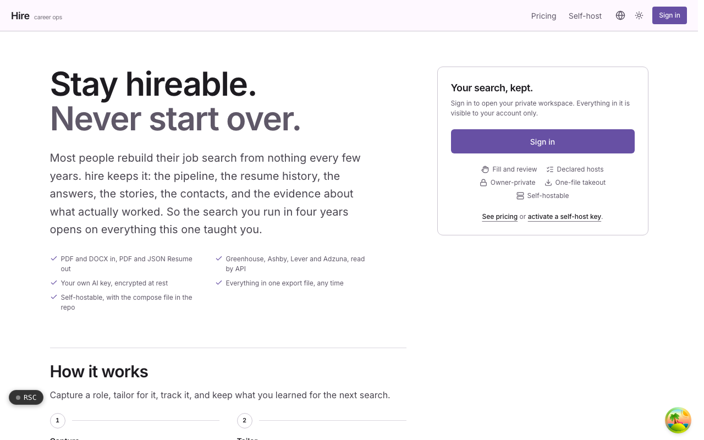
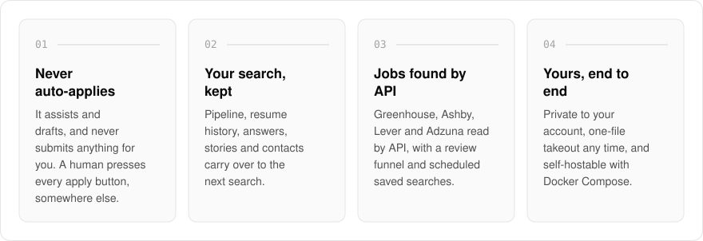
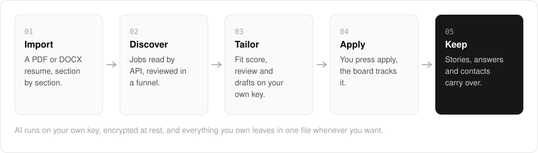
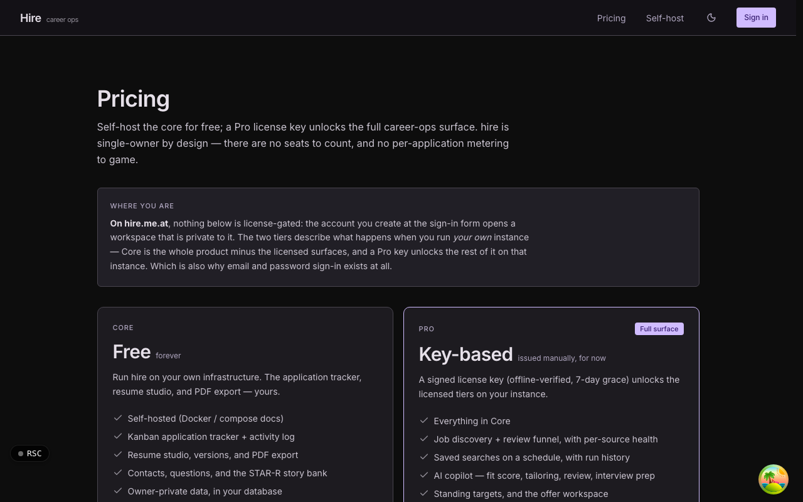

  <picture>
    <source media="(prefers-color-scheme: dark)" srcset=".github/assets/hero-dark.png">
    
  </picture>

<h1 align="center">hire.me.at</h1>

<strong>Stay hireable. Era after era.</strong>

  
  
  
  

  <a href="https://hire.me.at">Website</a> ·
  <a href="#features">Features</a> ·
  <a href="#how-it-works">How it works</a> ·
  <a href="#screenshots">Screenshots</a> ·
  <a href="#built-with">Built with</a>

Most people rebuild their job search from nothing every few years. I built hire.me.at as career ops for one job seeker, and it keeps the search: the pipeline, the resume history, the answers, the stories, the contacts, and the evidence about what actually worked. It assists and never auto-applies, so a human presses every apply button. Everything in your workspace is private to your account, and the whole thing is self-hostable.

  <picture>
    <source media="(prefers-color-scheme: dark)" srcset=".github/assets/overview-dark.svg">
    
  </picture>

## Why hire.me.at

| The usual job search | hire.me.at |
| --- | --- |
| Rebuilt from nothing every few years | Pipeline, resumes, answers and stories carry over to the next search |
| Tools that apply on your behalf | It assists and drafts; you press every apply button |
| Listings scraped from job boards | API-only discovery with a review funnel and per-source health |
| Your history locked inside a tracker | One-file takeout any time, and self-hostable |

## Features

- **Application pipeline**: a kanban tracker with an activity timeline, interview scheduling and debriefs.
- **Resume studio**: sections, layouts and templates, with restorable version history and PDF, JSON and JSON Resume export.
- **Import your existing resume**: PDF and DOCX import with accept-or-skip cards for each parsed section.
- **API-only job discovery**: Greenhouse, Ashby, Lever and Adzuna read by API, with a review funnel, per-source health and saved searches on a schedule.
- **Bounded AI copilot**: fit score, review, tailoring, interview prep, and cover letter and outreach drafts, using your own AI key, encrypted at rest.
- **What you already worked out**: a contact book, a question bank and a STAR-R story bank that carry over to the next search.
- **One-file takeout**: export everything you own in one file, any time.
- **Self-hostable**: run the core on your own infrastructure with Docker Compose; a Pro license key unlocks the full surface.

## How it works

  <picture>
    <source media="(prefers-color-scheme: dark)" srcset=".github/assets/flow-dark.svg">
    
  </picture>

You start by importing a PDF or DOCX resume, accepting or skipping each parsed section. Discovery reads job boards by API and sends new roles through a review funnel, and the copilot scores fit and drafts tailored material using your own AI key. You apply yourself, the pipeline tracks each application through interviews and debriefs, and your stories, answers and contacts stay in the workspace for the next search.

## Screenshots

<table>
  <tr>
    <td width="50%"><picture><source media="(prefers-color-scheme: dark)" srcset=".github/assets/hero-dark.png"></picture> The public home page, before you sign in to the console.</td>
    <td width="50%"><picture><source media="(prefers-color-scheme: dark)" srcset=".github/assets/pricing-dark.png"></picture> Pricing: a free self-hosted core and a key-based Pro tier.</td>
  </tr>
</table>

## Built with

  
  
  
  
  
  
  

- Next.js 16 (App Router), React 19, TypeScript
- Tailwind CSS 4
- oRPC for the typed API
- Drizzle ORM + Postgres
- Better Auth (the shared me.at account)
- React PDF, mammoth and unpdf for resume export and import
- Bring-your-own-key AI providers (OpenAI, Anthropic, Gemini, OpenRouter, Ollama)

## Part of the me.at family

hire.me.at is one of my [`*.me.at`](https://me.at) apps. They share one design system, account, and app shell. Development happens in a private monorepo; this repository is the project's public-facing home.

## License

Source-available. See [LICENSE](LICENSE).
